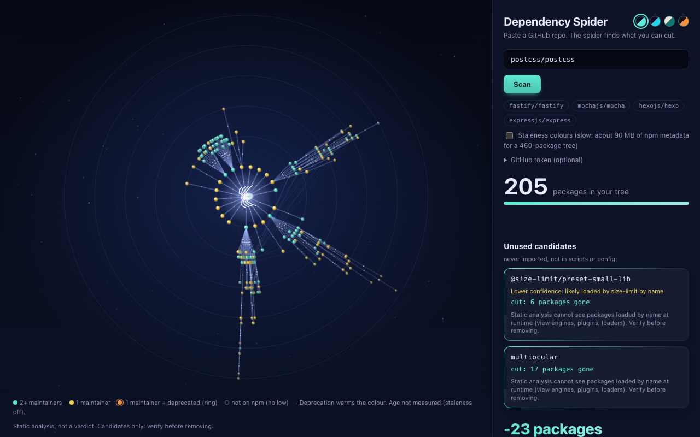
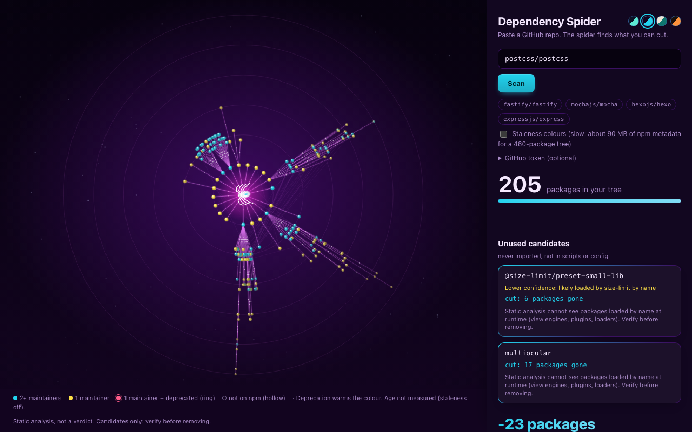
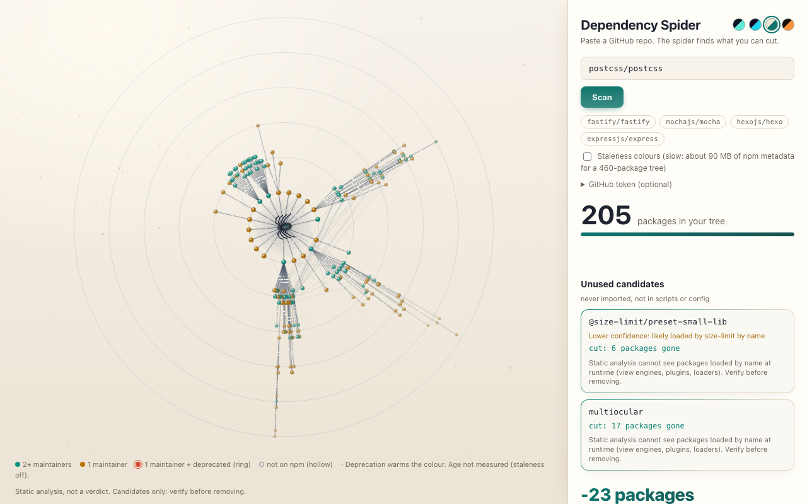
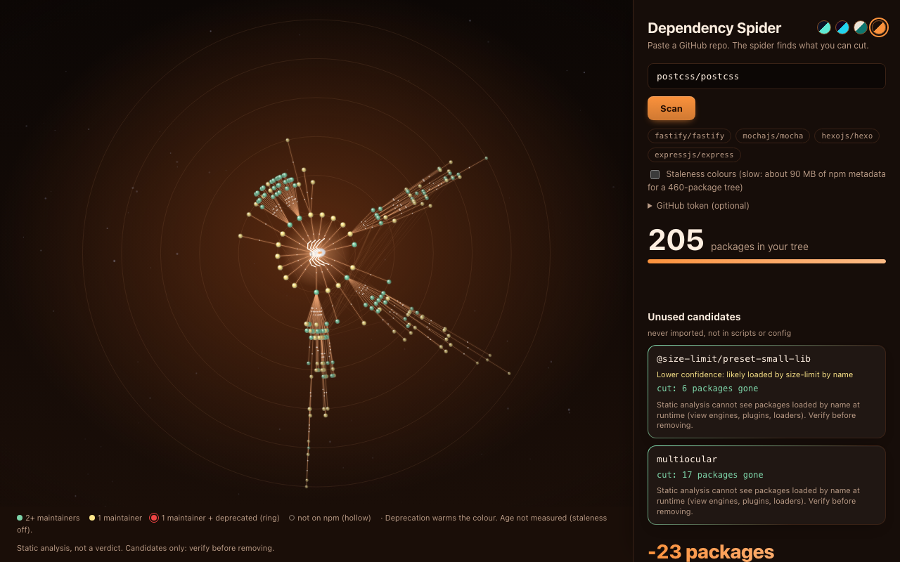
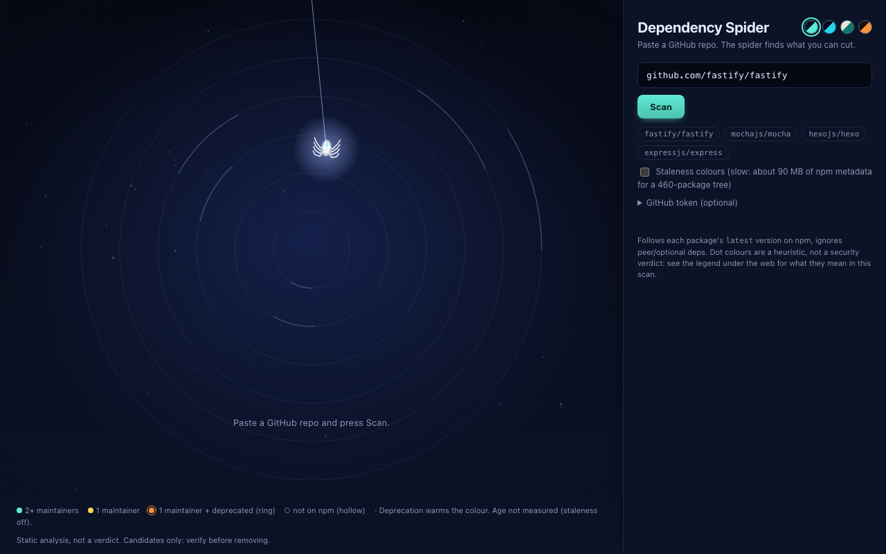
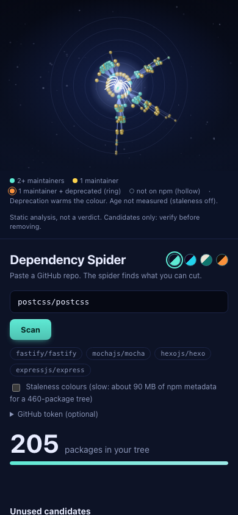
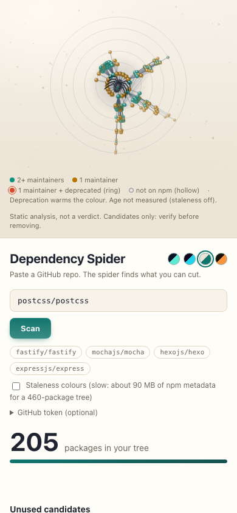

# Dependency Spider

Paste a GitHub repo and watch a spider find the dead libraries in it, and show how much of the dependency tree you can cut.

**Live demo:** https://devsutharsystems.github.io/dependency-spider/ (the site URL once Pages is enabled; not yet opened or tested, see "Not verified" below).

A static website: no backend, no build step, no API key, no LLM. Everything runs in your browser against three free public sources (GitHub raw files, the GitHub trees API, the npm registry).




Four themes (pick one with the dots next to the title; the default follows your system light/dark setting):

| Midnight Silk | Neon Arachnid |
|---|---|
|  |  |
| **Dawn Dew** | **Ember Forge** |
|  |  |

| Empty state (Midnight Silk) | Phone, Midnight | Phone, Dawn |
|---|---|---|
|  |  |  |

All 16 screenshots (4 themes, desktop and phone, empty and result state) are in [docs/screenshots/](docs/screenshots/). They were taken with headless Chromium from a recorded scan of postcss/postcss on 2026-10-16.

## What it is, honestly

[depcheck](https://github.com/depcheck/depcheck) and [Knip](https://knip.dev) already find unused dependencies, and they are more mature than this. They also run locally, parse real ASTs and understand many tool plugins. This project does not try to beat them at detection.

What is different here:

1. **What a removal sheds from the transitive tree.** For every candidate it computes how many packages actually disappear (or names the package that still needs it: "still needed by neostandard, removing it will not shrink the tree"), plus the overlap-aware total when all candidates go together.
2. **The visualization** of the tree being crawled and the candidates being cut.
3. **A public comparison against depcheck** (table below), including where this scanner is worse.

The wording is deliberately "candidates, verify before removing". Nothing here is a verdict.

## Run it

```sh
python3 -m http.server 8000     # from this folder; the path may contain spaces, quote it
# open http://localhost:8000
```

Deep link: `http://localhost:8000/?repo=fastify/fastify` (add `&auto=0` to fill the box without scanning).

Tests (offline, Node 18+):

```sh
npm test            # = node --test test/*.test.mjs
```

Real-network checks (put a token in `GITHUB_TOKEN` to avoid the 60 requests/hour limit):

```sh
node scripts/acceptance.mjs [fastify|hexo|mocha|all]
node scripts/validate.mjs [owner/repo ...]      # writes results/validation.md, needs git + npx
```

Animation performance on a recorded scan (no network; needs Playwright installed somewhere, see the header of the script):

```sh
node scripts/record-fixture.mjs owner/repo name                  # once, needs network: scripts/fixtures/<name>.json
PW_DIR=<playwright folder> node scripts/perf.mjs debug --dpr=2 --throttle=4
# the app can also replay a fixture: http://localhost:8000/?fixture=scripts/fixtures/postcss.json
```

## How it works

| Step | File | What happens |
|---|---|---|
| 1 | `github.js` | Parse the URL, list files with the trees API (`HEAD`, falling back to the default branch), fetch `package.json`. Pick up to 300 source files, real source first and tests last, plus root configs, every `tsconfig*.json`, `.husky/*` and up to 20 extensionless scripts that start with `#!`. |
| 2 | `extract.js` | Regexes for `from 'x'`, `import 'x'`, `import('x')`, `require('x')`, `require.resolve('x')`. Only whole-line `//` comments are stripped (stripping `/* */` would let globs like `lib/*.js` swallow real imports). Built-ins and `node:` are excluded. |
| 3 | `analyze.js` | A dependency is **used** if imported anywhere, or mentioned (token-bounded) in `scripts`, in any other `package.json` key except the dependency maps, or in config files; also by its registry bin names and tool shorthands. Not imported and not mentioned = **ghost**. |
| 4 | `registry.js` | BFS crawl of the npm registry from all declared deps (depth ≤ 6, cap 900 packages, 8 parallel requests, retry with backoff). |
| 5 | `graph.js` | Reachability before/after removing each ghost and all ghosts together. |
| 6 | `choreo.js` | The animation's brain (pure, no DOM): an incremental fixed radial layout and the spider's planner. See "The animation" below. |
| 7 | `viz.js` | Draws it on two stacked canvases (a static web layer and a small live layer). |

## Themes and depth cues

- **One palette object** (`src/theme.js`) feeds both the CSS variables and the canvas, so a theme cannot drift between page and picture. The share image is drawn in the active theme too. The choice is saved in `localStorage` inside a try/catch; the page works without it.
- **Depth is 2.5D, drawn in plain canvas 2D plus CSS:** pre-rendered dewdrop sphere sprites cached per colour and depth level, deeper rings smaller, dimmer and fogged toward the background, silk as a faint wide stroke plus a thin core that fades with depth, a spark burst (pooled, at most 60 particles) when the spider snips, a CSS-drifted dust layer, a vignette, and a perspective tilt of at most 4 degrees that follows the pointer (off on touch devices and with `prefers-reduced-motion`). No WebGL, no `backdrop-filter`, no external fonts.
- **Accessibility was measured, not assumed** (`scripts/contrast.mjs`, enforced by `test/theme.test.mjs`; raw numbers in [results/theme-contrast.txt](results/theme-contrast.txt)): node colours at least 3:1 against the background and its centre glow, body and legend text at least 4.5:1, and under a deuteranopia simulation the node colours stay distinguishable. Three hexes failed the 3:1 rule and were adjusted (`dawn.c2 #0f9d8a` to `#0e9280`, `dawn.cmiss #94a3b8` to `#768293`, `ember.cmiss #7c6a5c` to `#8e7f73`). Two non-colour cues were added in every theme because colour alone was not enough: **orange/red packages get a ring** and **not-on-npm packages are drawn hollow**. The legend says so and its swatches carry the same cues.

## Smoothness controls

The page measures its own frame rate. **Effects: Auto / Full / Lite** (a selector in the panel, with a plain-text readout such as "Auto: tier 1"):

- **Auto** (default): tier 2 on desktop, tier 1 on touch devices. If the rolling 60-frame p95 frame interval stays above 22 ms for 1.5 s it drops one tier for the rest of the session; it never goes back up by itself.
- **Full**: tier 2 and never steps down. **Lite**: tier 0.
- `?tier=0|1|2` in the URL forces a tier (for testing on a phone). The Auto/Full/Lite choice is saved in `localStorage` if the browser allows it; the page works without it.

| Tier | Keeps | Drops |
|---|---|---|
| **2** (Full; Auto on desktop) | everything: themes, restyled panel, dewdrop sphere sprites, depth fog, wide glow pass, additive blending, spider halo, dust and vignette, glints, sparks, idle sway and ring shimmer, pointer tilt, native pixel ratio (capped at about 2.5 megapixels per canvas) | nothing |
| **1** (Auto on touch) | everything above except the two below | the pointer tilt and the idle ring shimmer |
| **0** (Lite) | themes, restyled panel, sphere sprites, halo, dust, vignette, silk, legend cues | pixel ratio forced to 1, depth fog, glints, sparks, wide glow pass, additive blending, idle animation (the spider hangs still and the loop stops) |

These cuts follow measured costs ([results/lag-diagnosis.md](results/lag-diagnosis.md)): the cheap effects (halo, fog, glints, sparks, glow pass, additive blending) cost 0 to 0.3 ms per frame on a real GPU, so they stay in tier 1; the expensive things were extra full-size layers, the pointer tilt and an animation loop that never stopped. The frame loop now stops when nothing is animating, and the dust and vignette are one static CSS background.

## The animation

The spider builds the web; it is not a canned video. `choreo.js` is a pure module (no DOM, no clock):

- **Input:** the packages in the order the npm crawl delivers them (name, depth, parent, dependency list) and the canvas geometry.
- **Layout (`WebLayout`):** a fixed radial layout that is built incrementally. Ring = depth. Each package gets an angular slot inside its parent's wedge (an equal share per child that parent announced) the moment it is delivered, and never moves afterwards, so the spider can start before the crawl finishes. **The limit:** equal shares ignore how big a branch will become, so heavy branches get crowded wedges (the long columns in fastify's web). A small radial stagger helps but does not fix it.
- **Planner:** decides where the spider goes next using only delivered packages, only along threads that exist. It lays the spokes (declared dependencies) first, then fills each wedge; to reach more work it walks back along existing threads, faster; with nothing ready it returns nothing, so the spider hangs and waits for npm instead of wandering. The first 15 packages run at natural speed, then it accelerates (up to 14x) so a 464-package tree takes about 23 s.
- **Output:** steps (`drop`, `lay`, `return`) with paths, speeds and rests, and `planWeb` for a whole timeline.
- **Invariants (unit-tested in `test/choreo.test.mjs`):** a package exists only after the spider reached it and after its parent; the thread tip is exactly the spider's position; consecutive steps join with no jump; a return is a chain of parent/child pairs; a package delivered after the spider left its parent is still reached; the build fits the time budget.

`viz.js` draws it on **two stacked canvases** so a frame never repaints the whole web: a static layer (rings, anchored threads and packages) that is only drawn into when the spider anchors something or packages are removed, and a small live layer (spider, thread being laid, dew glints, snip flashes, falling packages) cleared with a dirty rectangle. Threads are batched into `Path2D` strokes, packages into 16 colour buckets; no `shadowBlur`, no filters, pre-rendered glow sprites, devicePixelRatio clamped to 2, time-based movement with a clamped delta, no allocation in the frame loop, no work in a hidden tab, page counters written at most 10 times a second. In the prune phase the spider walks existing threads to the hub, snips a candidate's thread (flash, two ends recoil), and only packages in the shed report grey out, fall and fade; still-needed packages stay. **Skip animation** jumps to the finished state, **Replay animation** re-runs from the cached result, and `prefers-reduced-motion` shows the end state.

**Performance** was measured in headless Chromium on one machine, on a recorded 682-package scan: frame-interval p95 in the worst case (retina DPR 2, 4x CPU throttle) went from 83 ms (build) and 100 ms (prune) to 16.7 ms and 16.8 ms, with rare single-frame hitches of up to 150 ms still present. Method, all numbers, the root cause and what is still off: [results/animation-perf.md](results/animation-perf.md). Those numbers are not from a real GPU, Safari, Firefox or a phone.

Other findings: **misplaced** (a prod dependency only used from tests/examples/scripts) and **phantom** (imported but not declared) appear under "Also found".

Fragility colour: `min(1, 0.6*min(staleDays/1460,1) + 0.4*(maintainers==1) + 0.3*deprecated)`. It is a heuristic, not a security verdict, and `modified` from the registry is only a proxy for the last publish. Without the optional staleness pass every package has staleness 0, so the colour then shows only the maintainer count (green: several, yellow: exactly one) and deprecation, not age. A one-line legend under the web says which of the two applies to the current scan.

## Data sources

- `raw.githubusercontent.com/<owner>/<repo>/HEAD/<path>`: file contents.
- `api.github.com/repos/<o>/<r>/git/trees/HEAD?recursive=1`: file list. 60 requests/hour per IP without a token; each scan uses 1 (2 if `HEAD` 404s). The optional token field is sent only as an `Authorization` header to `api.github.com` and is not stored.
- `registry.npmjs.org/<name>/latest` (a few KB) for the tree, bins, maintainers, deprecation. Only an `Accept` header is sent, so browsers need no CORS preflight.
- `registry.npmjs.org/<name>` abbreviated packument for `modified`, only if you tick the staleness box. It is big: **93 MB for fastify's 464 packages** (typescript alone is 8.7 MB), which is why it is optional and runs after the tree is built.

## Limits (read these)

- **Regex, not a parser.** Dynamic `require(variable)`, string-built paths and config-only usage the scanner cannot see will create false ghosts. Anything it over-counts hides a ghost instead (the safe direction).
- **Follows `latest`, not your lockfile.** The crawl takes the newest version of each package and ignores semver ranges, peer and optional dependencies. Your real installed tree differs. Shed numbers are an estimate of that model.
- **`modified` is a proxy** for the last publish, and colours are a heuristic.
- **File cap.** At most 300 source files are read (tests last). Big repos (mocha: 478 eligible files) can have usage in unread tests; the UI shows a warning when this happens.
- **Nested configs are not read.** Only root configs, `tsconfig*.json` anywhere, `.husky/*` and a few scripts. Usage that lives only in a nested fixture config (mocha's `tsx`) is missed.
- **Names resolved at runtime from strings are invisible**: view engines, plugins and loaders. Confirmed by removal tests: express's `hbs` (6 tests fail without it) and postcss's `@size-limit/preset-small-lib` (size-limit loads it by name; `test:size` fails without it). Karma auto-loads `karma-*` packages, and debug's `karma.conf.js` names `karma-browserify`, `karma-mocha` and (through the `ChromeHeadless` launcher) `karma-chrome-launcher` only by short name, so those three debug candidates are very probably false positives too (config read, tests not run: [results/karma-note.md](results/karma-note.md)). Treat every candidate as something to verify.
- **Config keys.** A top-level package.json key counts as a mention of a package only when its name is exactly a declared package's name (`"simple-git-hooks": {...}`, `"lint-staged": {...}`). Metadata keys and the dependency maps never count. A tool configured under a different key is only found if its name appears in the value. (The exact-key rule was added after the postcss removal test showed `simple-git-hooks` was wrongly flagged.)
- **"Lower confidence" badge is a heuristic and is not validated.** A candidate whose scope equals a used package's name (`@size-limit/...` with `size-limit`) or whose name starts with `<used package>-` (`karma-mocha` with `karma`) is shown as "likely loaded by <parent> by name". It is a general rule (no list of names; parents shorter than 4 characters are ignored), but I wrote it after seeing the postcss and debug results, so those results are not independent evidence for it. In the 13-repo run it marks 8 of the 13 candidates (fastify's two `@stylistic` packages via `eslint`, postcss's size-limit preset, axios's `@vitest/browser` via `vitest`, and four in debug); I have not checked whether those are the right ones.
- **Crowded wedges.** The animation's layout is incremental (each package gets an equal share of its parent's wedge when it is delivered), so heavy branches look denser than a layout by subtree size would. Cross threads (shared dependencies) are drawn once, faintly, after the build, not laid by the spider.
- **Package cap of 900** and depth 6; the UI warns when reached.
- **JS/TS only, root `package.json` only.** `workspaces` stops with a monorepo message.
- **GitHub API limit:** 60 requests/hour unauthenticated.
- Packages that are also Node built-in names (`events`, `buffer`...) are never reported (ambiguous), nor `@types/*`, nor local `file:`/`./` dependencies. A dependency that another package lists as a peer (typescript for tstyche) is listed separately instead of as a ghost. `webpack-cli` counts as used when `webpack` is.
- Private repos, GitLab and non-JS projects are out of scope.

## Verified vs not verified

**Verified (I ran it, 2026-10-16, on this machine):**

- Buttons, in headless Chromium on postcss/postcss: Copy command puts the exact command on the clipboard (and shows "Copy failed" when the clipboard is denied), PR text fills a box and copies it, Download image produces a valid 1200x630 PNG. A second scan without reload and an invalid URL after a good scan both reset the UI cleanly.
- 80 offline unit tests pass (`npm test`, also with `fetch` replaced by a function that throws): every trap listed above has a test, including config-key mentions, the dependency-map exclusion, the caveat line, the lower-confidence rule, the animation choreography invariants, and the theme palettes (contrast at least 3:1 for node colours and 4.5:1 for text, colour-blind distinguishability) (built-ins, bare `test`, glob with `/*`, dependency-map trap, `tap` vs `tape`, bin names, shorthands, `.bin` paths, misplaced, phantom, own name, file-cap ranking, URL forms, fake-registry BFS/depth/cap/scoped names/404/cycles, shed math with shared dependencies, still-needed-by, overlapping combined shed).
- The GitHub trees API accepts `HEAD` (HTTP 200, `{sha,url,tree,truncated}`, `access-control-allow-origin: *`, 60/hour limit; HTTP 404 for a missing repo).
- Acceptance on live repos (`scripts/acceptance.mjs`): see the next section.
- The UI in a real headless Chromium (Playwright): intro, scan, crawl, prune and summary phases. All four themes were checked on a recorded postcss scan (zero console errors, no horizontal overflow at 1280 px and at 390 px; screenshots in `docs/screenshots/`). Live scans (postcss, fastify, mocha, chalk) were run earlier, before the theme work, and were not repeated in every theme. Error messages for a bad URL, missing repo, repo without `package.json` and a monorepo (babel/babel) were produced by the real pipeline.

- Themes (headless Chromium, 2026-10-16): the default follows `prefers-color-scheme`, clicking a theme switches the CSS variables, canvas and legend swatches, the choice survives a reload, and it still switches with `localStorage` blocked. Screenshots of every theme, desktop and phone, empty and result state, were looked at (docs/screenshots). The share image is 1200x630 in all four themes. The pointer tilt peaks below 4 degrees and is off for reduced motion and touch. Performance before and after: `results/animation-perf.md`.

**Not verified:**

- Firefox/Safari, a real phone, and the rate-limit error in a browser (the rate-limit path is unit-tested with a fake response only).
- The GitHub Pages workflow (`.github/workflows/pages.yml`) has never run. The deployed site has not been opened.
- The Pages workflow on Node 24 (never run on GitHub).
- The 900-package cap path and the 429 retry path against the real registry (unit-tested with fakes only).
- Behaviour on repos outside the ones listed here.

## Acceptance

Run on 2026-10-16 with `node scripts/acceptance.mjs` against live repos (these change over time):

- **fastify/fastify** (50 declared, 282 source files, tree 464 packages): candidates are `@stylistic/eslint-plugin` (still needed by neostandard, sheds 0) and `@stylistic/eslint-plugin-js` (sheds 1); total 464 to 463. The three ghosts I was told to expect were **not** reproduced: `branch-comparer` is not flagged because fastify's current `bench` script runs `branchcmp`, which is the bin of `branch-comparer` (I checked both). `typescript` was flagged at first and is now reported separately because `tstyche` lists it as a peer dependency.
- **hexojs/hexo**: `hexo-cli` is not flagged (it is required by the extensionless `bin/hexo`). 0 candidates.
- **mochajs/mocha**: 1 candidate, `tsx`, which is a false positive: it is only referenced from a nested fixture `.mocharc.yml` under `test/integration/fixtures/`, which is not fetched, and the 300-file cap leaves 178 test files unread. Earlier flags that I fixed: `@test/esm-only-loader` (a local `./test/...` path dependency, now skipped), `webpack-cli` (companion of `webpack`, now counted as used), and three phantom `astro*` packages (they come from `docs/`, which has its own `package.json`, now ignored). `npm-run-all2`, `typescript` were not flagged in this run.

## Scanner vs depcheck

Neither tool was measured against ground truth, so no precision or recall numbers are claimed, and nothing here says this scanner is more accurate than depcheck. Agreement between the two is not correctness either: both tools flagged `hbs` (express) and `@size-limit/preset-small-lib` (postcss), and removing them broke something (see below).

### 1. depcheck with dependencies installed (3 repos)

depcheck re-run after installing each repo's dependencies, which is the fair way to run it (`scripts/depcheck-installed.mjs`, details in [results/validation-installed.md](results/validation-installed.md)):

| Repo | depcheck, installed | My candidates | Both | Only mine | Only depcheck |
|---|---|---|---|---|---|
| postcss/postcss | 4 | 2 | 2 | 0 | 2 (`simple-git-hooks`, `ts-node`) |
| expressjs/express | 1 | 1 | 1 | 0 | 0 |
| debug-js/debug | 3 | 4 | 2 | 2 (`karma-browserify`, `karma-mocha`) | 1 (`brfs`) |
| **Total** | **8** | **7** | **5** | **2** | **3** |

depcheck still flags `simple-git-hooks` after installing; the postcss removal test below shows it is in use through its config key, so that disagreement is a depcheck miss, not mine. On debug, depcheck does not flag `karma-browserify` and `karma-mocha`, which this scanner does; `karma.conf.js` names both by short name (see the Karma note under limits), so those two are very probably false positives of this scanner.

### 2. Removal tests: 4 candidates tested, 3 wrong, 1 unconfirmed, 0 confirmed unused

Candidates were removed in throwaway clones of two repos and the repos' own scripts re-run. A pass means "the tests do not need it", not "nothing needs it".

- **express: 1 candidate (`hbs`), wrong.** Tests went from 1261 passing to 1255 passing, 6 failing (the `mvc` example). Express loads view engines by name at runtime (`exports.engine = 'hbs'`). [results/removal-test.md](results/removal-test.md)
- **postcss: 3 candidates, 2 wrong, 1 unconfirmed.** This test ran on the scanner as it was *before* the config-key fix, which reported three candidates. With all three removed, the unit tests (720/720), lint, type tests, version check and integration script still pass, but `test:size` fails: `size-limit` loads `@size-limit/preset-small-lib` by name. Removed one at a time, only that package breaks anything. `simple-git-hooks` is configured by its own top-level key in `package.json` (it installs the pre-commit hook; no test notices): that was a scanner bug, fixed by the config-key rule above, and it is no longer reported. `multiocular` is referenced nowhere in the repo and its removal broke nothing I ran, which does not confirm it is unused. [results/removal-test-postcss.md](results/removal-test-postcss.md)

Tally: `hbs`, `@size-limit/preset-small-lib` and `simple-git-hooks` were wrong; `multiocular` is unconfirmed; **0 of the 4 are confirmed unused.** Two repos is not a measurement. It shows that "candidate" has to be read literally, and the UI says so under every candidate.

### 3. 13-repo comparison: depcheck WITHOUT installing dependencies

[results/validation.md](results/validation.md), from `node scripts/validate.mjs` on 13 popular non-monorepo projects. depcheck ran in a shallow clone with no install, so it cannot see the bins of installed tools and flags many CLI tools that scripts clearly use. **Its 84 flags are therefore inflated and are not a fair baseline.** The installed re-run above is: on those 3 repos depcheck's flags fell from 23 to 8. (After the config-key fix the scanner side was re-run with `--reuse`, keeping depcheck's original output.)

| | Candidates |
|---|---|
| This scanner | 13 |
| depcheck, no install | 84 (excluding `@types/*`) |
| In both | 13 |
| Only this scanner | 0 |
| Only depcheck | 71 |

The two never reported the same full set on any of the 13 repos. Where this scanner is weaker than depcheck: it cannot tell a tool that is merely named in a script from one that actually runs, it misses usage hidden in unread files (mocha's `tsx`), it misses names resolved from strings at runtime, and its mention matching is lenient for short common names.

## Showcase run

`postcss/postcss`, run in the app on 2026-10-16 (headless Chromium, data in `docs/showcase/run.json`): 21 declared dependencies (3 prod, 18 dev), 63 of 63 source files scanned, dependency tree 228 packages. Candidates, both also flagged by depcheck: `@size-limit/preset-small-lib` (sheds 6, shown with the lower-confidence badge) and `multiocular` (sheds 17). Together: 228 to 205 packages (-23, 10.1% smaller). `typescript` is not reported because `@logux/oxc-configs` lists it as a peer dependency.

**-23 is an upper bound, not a saving you can bank.** 6 of the 23 come from `@size-limit/preset-small-lib`, which the removal test proved is needed (`test:size` fails without it). The other 17 come from `multiocular`, which is unconfirmed. Every shed number in this tool assumes the candidate really can be removed. The numbers move as npm publishes new versions.

## Deploy (GitHub Pages)

`.github/workflows/pages.yml` runs the tests, assembles `index.html`, `style.css`, `src/`, `docs/` and publishes them. After creating the repo, set **Settings, Pages, Source = GitHub Actions**. The site is fully static, so it also works from any static host.
