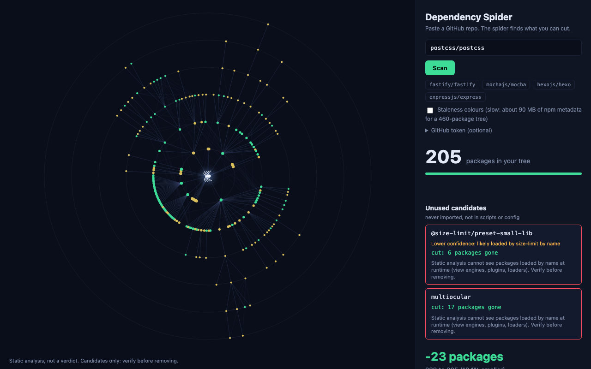
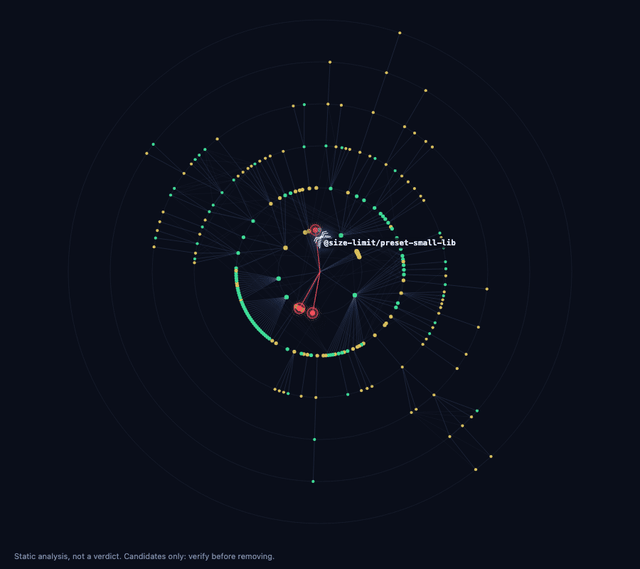
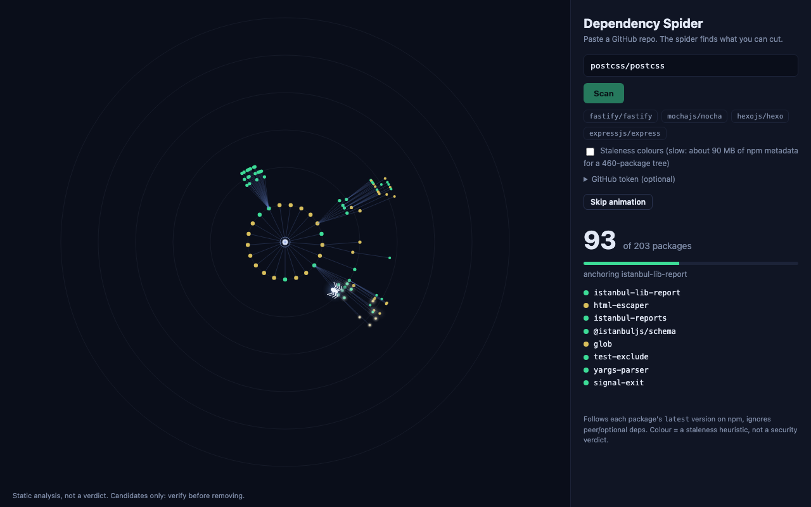
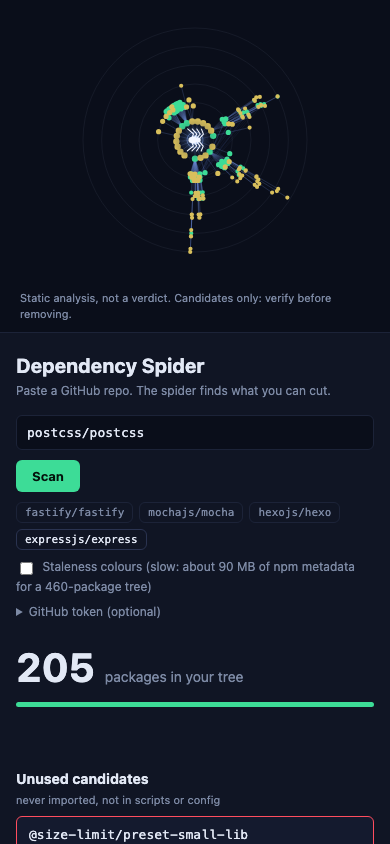

# Dependency Spider

Paste a GitHub repo and watch a spider find the dead libraries in it, and show how much of the dependency tree you can cut.

A static website: no backend, no build step, no API key, no LLM. Everything runs in your browser against three free public sources (GitHub raw files, the GitHub trees API, the npm registry).





| Crawl | Prune | Phone |
|---|---|---|
|  |  |  |

## What it is, honestly

[depcheck](https://github.com/depcheck/depcheck) and [Knip](https://knip.dev) already find unused dependencies, and they are more mature than this. They also run locally, parse real ASTs and understand many tool plugins. This project does not try to beat them at detection.

What is different here:

1. **What a removal sheds from the transitive tree.** For every candidate it computes how many packages actually disappear (or names the package that still needs it: "still needed by neostandard, removing it will not shrink the tree"), plus the overlap-aware total when all candidates go together.
2. **The visualization** of the tree being crawled and the candidates being cut.
3. **A public comparison against depcheck** (table below), including where this scanner is worse.

The wording is deliberately "candidates, verify before removing". Nothing here is a verdict.

## Run it

```sh
python3 -m http.server 8000     # from this folder; the path may contain spaces, quote it
# open http://localhost:8000
```

Deep link: `http://localhost:8000/?repo=fastify/fastify` (add `&auto=0` to fill the box without scanning).

Tests (offline, Node 18+):

```sh
npm test            # = node --test test/*.test.mjs
```

Real-network checks (put a token in `GITHUB_TOKEN` to avoid the 60 requests/hour limit):

```sh
node scripts/acceptance.mjs [fastify|hexo|mocha|all]
node scripts/validate.mjs [owner/repo ...]      # writes results/validation.md, needs git + npx
```

## How it works

| Step | File | What happens |
|---|---|---|
| 1 | `github.js` | Parse the URL, list files with the trees API (`HEAD`, falling back to the default branch), fetch `package.json`. Pick up to 300 source files, real source first and tests last, plus root configs, every `tsconfig*.json`, `.husky/*` and up to 20 extensionless scripts that start with `#!`. |
| 2 | `extract.js` | Regexes for `from 'x'`, `import 'x'`, `import('x')`, `require('x')`, `require.resolve('x')`. Only whole-line `//` comments are stripped (stripping `/* */` would let globs like `lib/*.js` swallow real imports). Built-ins and `node:` are excluded. |
| 3 | `analyze.js` | A dependency is **used** if imported anywhere, or mentioned (token-bounded) in `scripts`, in any other `package.json` key except the dependency maps, or in config files; also by its registry bin names and tool shorthands. Not imported and not mentioned = **ghost**. |
| 4 | `registry.js` | BFS crawl of the npm registry from all declared deps (depth ≤ 6, cap 900 packages, 8 parallel requests, retry with backoff). |
| 5 | `graph.js` | Reachability before/after removing each ghost and all ghosts together. |
| 6 | `layout.js`, `viz.js` | Fixed radial layout (rings = depth, angular sectors proportional to subtree size, no force simulation), canvas animation. |

Other findings: **misplaced** (a prod dependency only used from tests/examples/scripts) and **phantom** (imported but not declared) appear under "Also found".

Fragility colour: `min(1, 0.6*min(staleDays/1460,1) + 0.4*(maintainers==1) + 0.3*deprecated)`. It is a heuristic, not a security verdict, and `modified` from the registry is only a proxy for the last publish. Without the optional staleness pass every package has staleness 0.

## Data sources

- `raw.githubusercontent.com/<owner>/<repo>/HEAD/<path>`: file contents.
- `api.github.com/repos/<o>/<r>/git/trees/HEAD?recursive=1`: file list. 60 requests/hour per IP without a token; each scan uses 1 (2 if `HEAD` 404s). The optional token field is sent only as an `Authorization` header to `api.github.com` and is not stored.
- `registry.npmjs.org/<name>/latest` (a few KB) for the tree, bins, maintainers, deprecation. Only an `Accept` header is sent, so browsers need no CORS preflight.
- `registry.npmjs.org/<name>` abbreviated packument for `modified`, only if you tick the staleness box. It is big: **93 MB for fastify's 464 packages** (typescript alone is 8.7 MB), which is why it is optional and runs after the tree is built.

## Limits (read these)

- **Regex, not a parser.** Dynamic `require(variable)`, string-built paths and config-only usage the scanner cannot see will create false ghosts. Anything it over-counts hides a ghost instead (the safe direction).
- **Follows `latest`, not your lockfile.** The crawl takes the newest version of each package and ignores semver ranges, peer and optional dependencies. Your real installed tree differs. Shed numbers are an estimate of that model.
- **`modified` is a proxy** for the last publish, and colours are a heuristic.
- **File cap.** At most 300 source files are read (tests last). Big repos (mocha: 478 eligible files) can have usage in unread tests; the UI shows a warning when this happens.
- **Nested configs are not read.** Only root configs, `tsconfig*.json` anywhere, `.husky/*` and a few scripts. Usage that lives only in a nested fixture config (mocha's `tsx`) is missed.
- **Package cap of 900** and depth 6; the UI warns when reached.
- **JS/TS only, root `package.json` only.** `workspaces` stops with a monorepo message.
- **GitHub API limit:** 60 requests/hour unauthenticated.
- Packages that are also Node built-in names (`events`, `buffer`...) are never reported (ambiguous), nor `@types/*`, nor local `file:`/`./` dependencies. A dependency that another package lists as a peer (typescript for tstyche) is listed separately instead of as a ghost. `webpack-cli` counts as used when `webpack` is.
- Private repos, GitLab and non-JS projects are out of scope.

## Verified vs not verified

**Verified (I ran it, 2026-10-16, on this machine):**

- Buttons, in headless Chromium on postcss/postcss: Copy command puts the exact command on the clipboard (and shows "Copy failed" when the clipboard is denied), PR text fills a box and copies it, Download image produces a valid 1200x630 PNG. A second scan without reload and an invalid URL after a good scan both reset the UI cleanly.
- 51 offline unit tests pass (`npm test`): every trap listed above has a test (built-ins, bare `test`, glob with `/*`, dependency-map trap, `tap` vs `tape`, bin names, shorthands, `.bin` paths, misplaced, phantom, own name, file-cap ranking, URL forms, fake-registry BFS/depth/cap/scoped names/404/cycles, shed math with shared dependencies, still-needed-by, overlapping combined shed).
- The GitHub trees API accepts `HEAD` (HTTP 200, `{sha,url,tree,truncated}`, `access-control-allow-origin: *`, 60/hour limit; HTTP 404 for a missing repo).
- Acceptance on live repos (`scripts/acceptance.mjs`): see the next section.
- The UI in a real headless Chromium (Playwright): intro, scan, crawl, prune and summary phases for fastify and mocha, zero console errors, no horizontal overflow at 1280 px and at 390 px (screenshots in `docs/`). Error messages for a bad URL, missing repo, repo without `package.json` and a monorepo (babel/babel) were produced by the real pipeline.

**Not verified:**

- Firefox/Safari, a real phone, and the rate-limit error in a browser (the rate-limit path is unit-tested with a fake response only).
- The GitHub Pages workflow (`.github/workflows/pages.yml`) has never run. The deployed site has not been opened.
- The 900-package cap path and the 429 retry path against the real registry (unit-tested with fakes only).
- Behaviour on repos outside the ones listed here.

## Acceptance

Run on 2026-10-16 with `node scripts/acceptance.mjs` against live repos (these change over time):

- **fastify/fastify** (50 declared, 282 source files, tree 464 packages): candidates are `@stylistic/eslint-plugin` (still needed by neostandard, sheds 0) and `@stylistic/eslint-plugin-js` (sheds 1); total 464 to 463. The three ghosts I was told to expect were **not** reproduced: `branch-comparer` is not flagged because fastify's current `bench` script runs `branchcmp`, which is the bin of `branch-comparer` (I checked both). `typescript` was flagged at first and is now reported separately because `tstyche` lists it as a peer dependency.
- **hexojs/hexo**: `hexo-cli` is not flagged (it is required by the extensionless `bin/hexo`). 0 candidates.
- **mochajs/mocha**: 1 candidate, `tsx`, which is a false positive: it is only referenced from a nested fixture `.mocharc.yml` under `test/integration/fixtures/`, which is not fetched, and the 300-file cap leaves 178 test files unread. Earlier flags that I fixed: `@test/esm-only-loader` (a local `./test/...` path dependency, now skipped), `webpack-cli` (companion of `webpack`, now counted as used), and three phantom `astro*` packages (they come from `docs/`, which has its own `package.json`, now ignored). `npm-run-all2`, `typescript` were not flagged in this run.

## Validation against depcheck

Full table, every disagreement and the method: [results/validation.md](results/validation.md). Produced by `node scripts/validate.mjs` on 13 popular non-monorepo projects (depcheck run via `npx depcheck --json` in a shallow clone, **without installing dependencies**).

| | Candidates |
|---|---|
| This scanner | 15 |
| depcheck | 84 (excluding `@types/*`) |
| In both | 14 |
| Only this scanner | 1 (`lint-staged` in axios; `git grep` finds no other mention) |
| Only depcheck | 70 |

Honest reading:

- The two tools agree on **every** candidate this scanner reports except one, but they never report the same full set on any repo (0 of 13).
- This scanner is **much more conservative**: it reports about a fifth as many candidates. Almost all of depcheck's extra results are CLI tools (`eslint`, `mocha`, `nyc`, `c8`, `husky`, `prettier`, `typescript`, ...) that this scanner finds mentioned in `scripts` or config.
- **Most of that gap is depcheck running without an install.** On the 3 repos where I re-ran depcheck after `npm install --ignore-scripts` (table below), its flags fall from 23 to 8, and my 8 candidates and its 8 overlap on 6.
- This scanner has lower recall by design (over-counting usage), and neither tool was measured against ground truth. No precision or recall numbers are claimed.
- Where it is worse than depcheck: it cannot tell a tool that is merely named in a script from one that actually runs; it misses usage hidden in unread files (mocha's `tsx`); its mention matching is lenient for short, common names.

### depcheck with installing (3 repos)

Same repos, same scanner results, but depcheck re-run after `npm install --ignore-scripts --no-audit --no-fund --legacy-peer-deps` (`scripts/depcheck-installed.mjs`, details in [results/validation-installed.md](results/validation-installed.md)).

| Repo | depcheck, no install | depcheck, installed | My candidates | Both (installed) | Only mine now | Only depcheck now |
|---|---|---|---|---|---|---|
| postcss/postcss | 9 | 4 | 3 | 3 | 0 | 1 (`ts-node`) |
| expressjs/express | 4 | 1 | 1 | 1 | 0 | 0 |
| debug-js/debug | 10 | 3 | 4 | 2 | 2 (`karma-browserify`, `karma-mocha`) | 1 (`brfs`) |
| **Total** | **23** | **8** | **8** | **6** | **2** | **2** |

On debug, depcheck (installed) no longer flags `karma-browserify` and `karma-mocha`, which this scanner does. Karma plugins are loaded by short name (`frameworks: ['mocha']`), so these two are probably false positives of this scanner. I did not verify that by removing them.

### Removal test: 1 repo, 1 candidate, 1 false positive

On express, the one candidate (`hbs`) was removed in a throwaway clone: tests went from **1261 passing** to **1255 passing, 6 failing** (all in the `mvc` example acceptance test). Express loads view engines by name at runtime (`exports.engine = 'hbs'`), which a regex scanner and depcheck both miss. One repo is not a measurement: it only shows that "candidate" has to be read literally. Commands and output summary: [results/removal-test.md](results/removal-test.md).

## Showcase run

`postcss/postcss`, run in the app on 2026-10-16 (headless Chromium, `docs/showcase/`): 21 declared dependencies (3 prod, 18 dev), 63 of 63 source files scanned, dependency tree 228 packages. Candidates, all three also flagged by depcheck: `@size-limit/preset-small-lib` (sheds 6), `multiocular` (sheds 17), `simple-git-hooks` (sheds 1). Together: 228 to 204 packages (-24, 10.5% smaller). `typescript` is not reported because `@logux/oxc-configs` lists it as a peer dependency. That is a modest result, not a dramatic one, and it moves as npm publishes new versions.

## Deploy (GitHub Pages)

`.github/workflows/pages.yml` runs the tests, assembles `index.html`, `style.css`, `src/`, `docs/` and publishes them. After creating the repo, set **Settings, Pages, Source = GitHub Actions**. The site is fully static, so it also works from any static host.
